# nailong-agent-sdk - architecture diagrams

Every diagram below was drawn from the source on branch `sdk_fix` (commit `5812431`), not from
the reference docs alone. File names in the labels are real modules under
`src/nailong_agent_sdk/`. Render with any Mermaid viewer (GitHub, VS Code "Markdown Preview
Mermaid Support", mermaid.live).

Reading order: D1 (where things live) -> D2 (one agent run) -> D3-D5 (the memory contribution)
-> D6 (governed tool call) -> D7 (many agents) -> D8-D9 (evidence and debugging) -> D10
(contribution map).

---

## D1. Layers: who may import whom

The package is a strict stack. `foundations` imports nothing; `agent` sits on top of everything
except `integrations`/`mcp`. The model is *not* a layer: it is an untrusted proposal source that
the `agent` layer calls and the lower layers constrain.

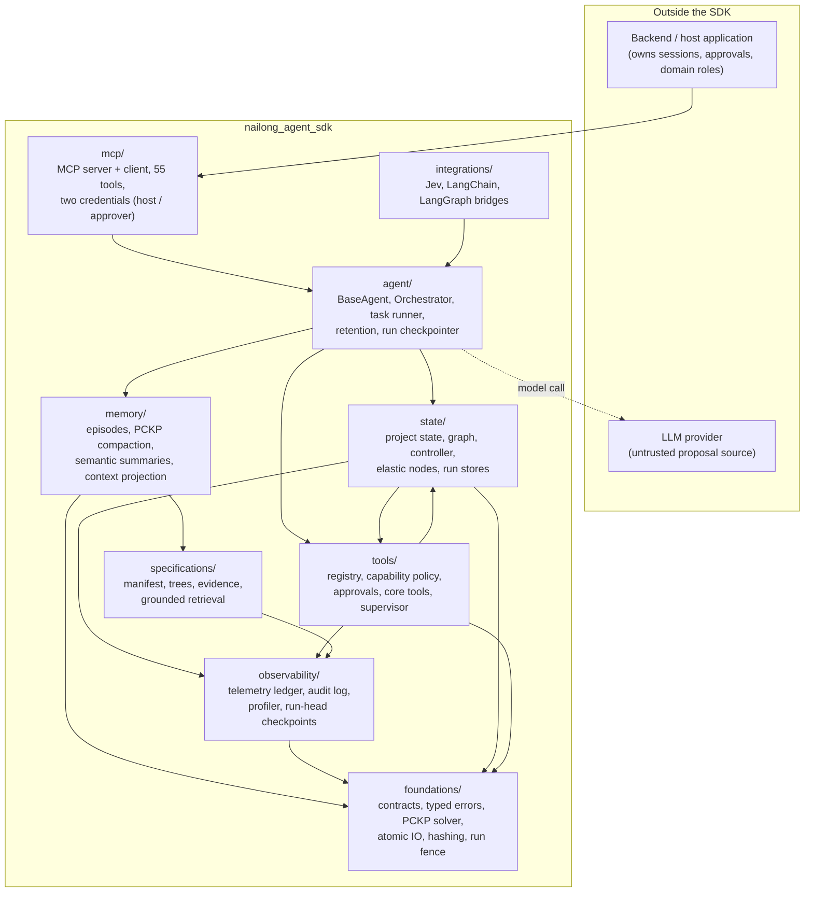

Two folder cycles exist and are deliberate: `tools <-> state` and `agent <-> integrations`; the
package root imports lazily so each module still imports cleanly on its own.

---

## D2. One agent run (`BaseAgent.run`)

The loop is deterministic apart from the single model call. Three guards stop the run before
the model is called; every exit goes through one `_terminate`.

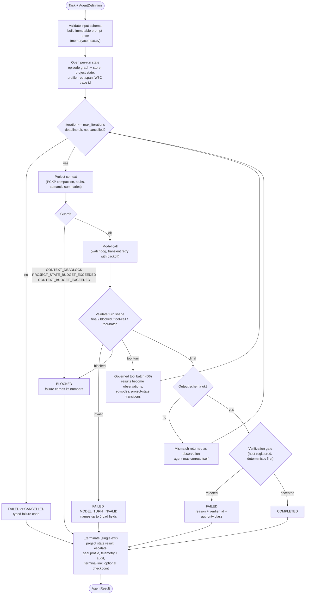

---

## D3. Memory architecture: what the model sees vs. what the harness keeps

This is the central picture. The model's context is a *projection*, rebuilt every turn, from
three typed stores. Nothing the model sees is the only copy of anything.

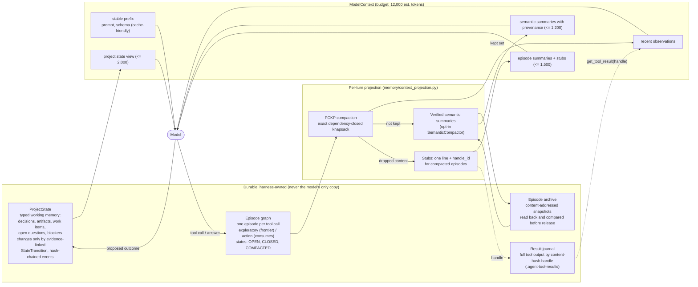

What flows where, in one sentence each:

- The **episode graph** holds what happened (a typed DAG; actions may only depend on the
  exploratory episodes they consumed - enforced in `memory/episodes.py`).
- **PCKP** decides which episodes keep their content under the token budget; closure over
  `depends_on` is mandatory, so an action is never kept without the observation it relied on.
- The **journal** keeps every full result; the model gets a bounded preview plus a handle.
- **Semantic summaries** digest the episodes PCKP did *not* keep, but only after archive and
  verification (D4). They are derived text and never count as evidence.
- **ProjectState** is separate from episodes: it is the harness's structured record of the task,
  not a transcript.

---

## D4. Semantic compaction: archive before release, verify before trust

A group that fails any step keeps its original payloads and is retried up to a limit. Groups
follow real `depends_on` edges, never similarity.

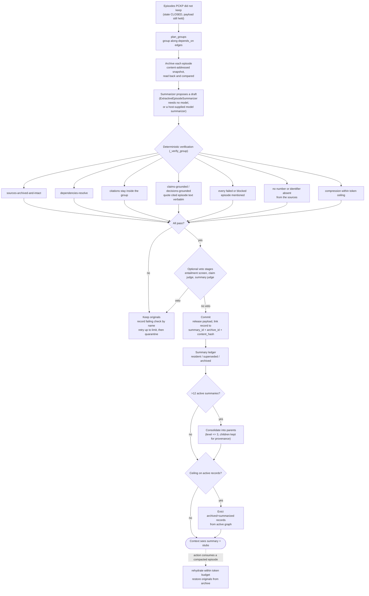

Order of trust: deterministic checks decide; a model judge may only *veto*, never approve.

---

## D5. Why this memory is debuggable: one question, three answers

The same failure is traced through a plain-text transcript memory and through this design.

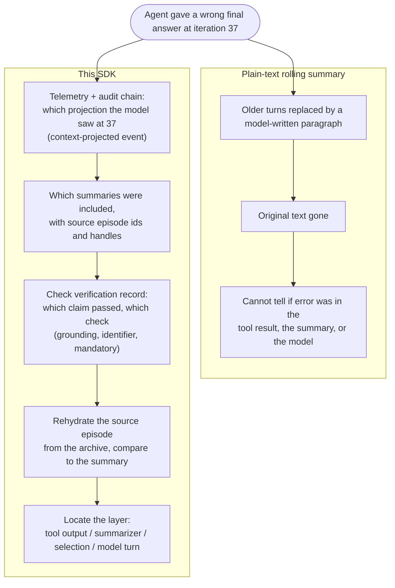

---

## D6. How one tool call is governed

The model can only *name* a tool. Whether it runs is decided by deterministic code, in order.

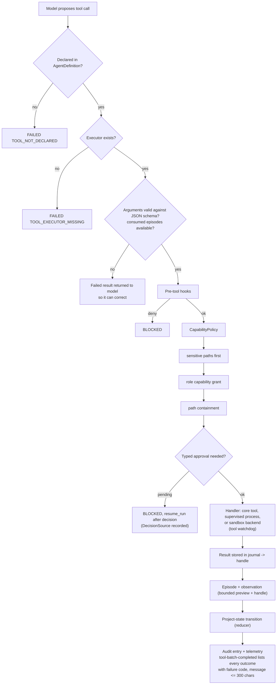

---

## D7. Many agents: controller, waves and elastic nodes

Agents never exchange conversation. They exchange typed discoveries and immutable values in
graph state, routed by exact reference.

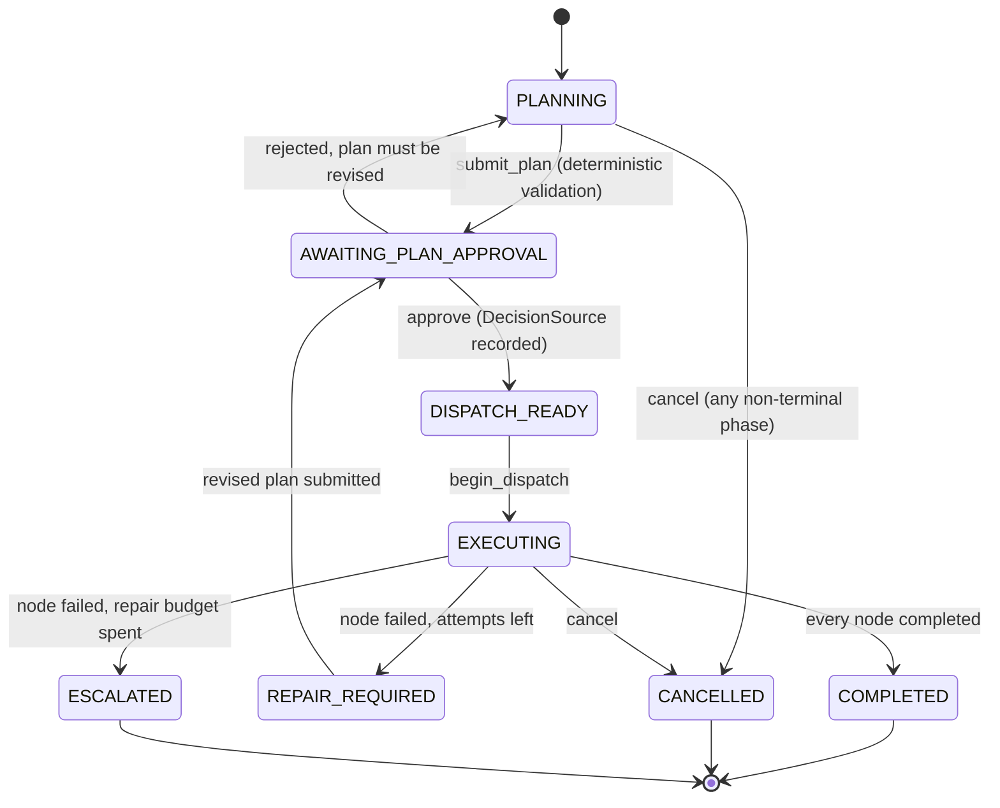

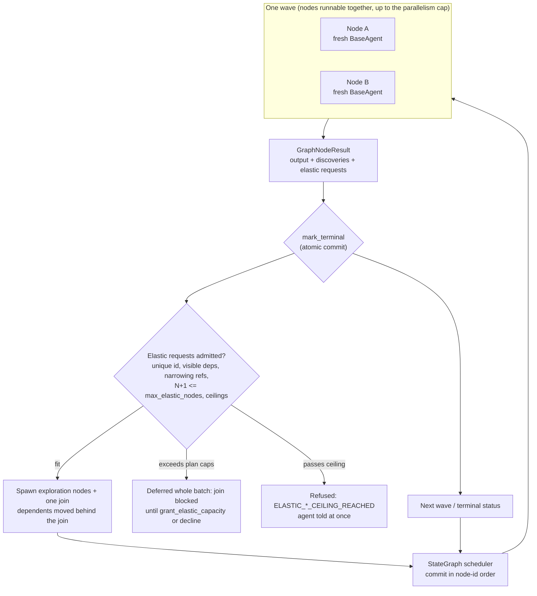

---

## D8. Evidence: independent records, cross-linked

Verifying a chain says the evidence can be trusted. The links between stores and the signed
checkpoint outside the run root are what catch tail truncation and a resealed chain.

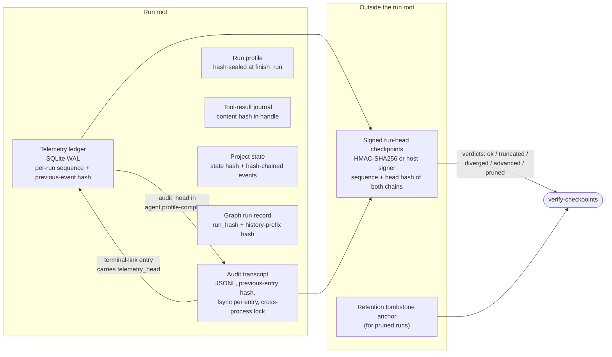

---

## D9. From failure to root cause

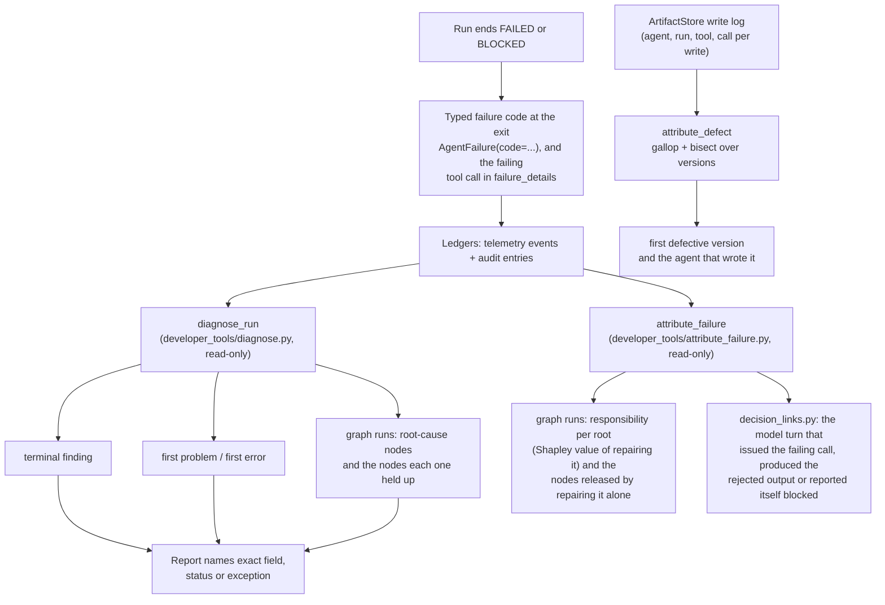

---

## D10. Contribution map: what is established vs. what is ours

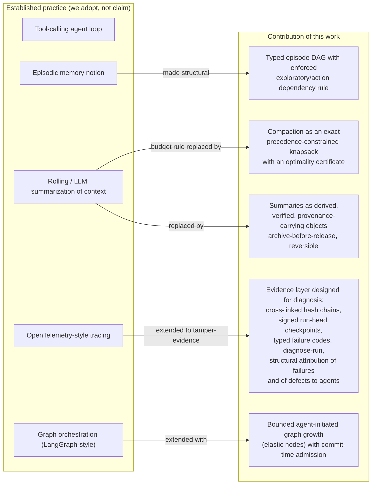
